# Blueprint Labs

**A hands-on SOC investigation training platform modelled on the Microsoft Defender XDR and Sentinel portal.**

Blueprint Labs gives analysts realistic security incidents to investigate end to end. You work through an incident queue, alerts, process trees, device timelines, identities and Advanced hunting with KQL, take response actions, and resolve the incident. You're scored on what you found, what you did and how quickly you contained it.

This repository is a project showcase. The platform itself is private and in active development, so there's no source code or scenario content here. Screenshots of investigations use demo scenarios that aren't part of the library, so nothing here gives away a scenario's answers.

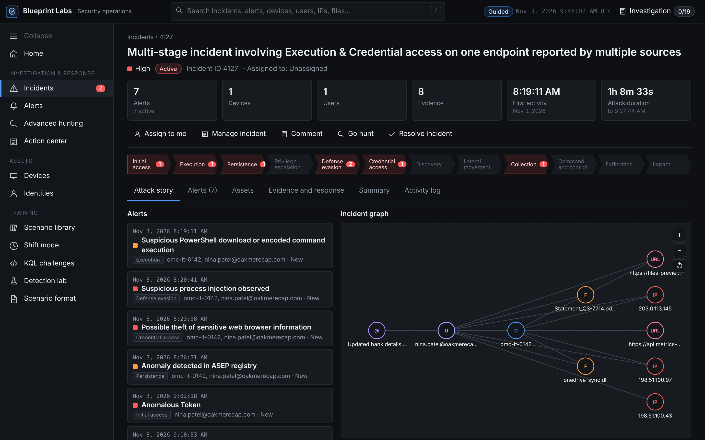

---

## Contents

- [The problem](#the-problem)
- [What it does](#what-it-does)
- [Scenario library](#scenario-library)
- [Training modes](#training-modes)
- [Design decisions](#design-decisions)
- [How it works](#how-it-works)
- [How it was built](#how-it-was-built)
- [Roadmap](#roadmap)

---

## The problem

Most analysts learn Defender and Sentinel on live incidents: under pressure, on real users, with no answer key at the end. The alternatives tend to fall short in one of two ways:

- **Capture-the-flag platforms** teach techniques well, but rarely in the tools a Microsoft SOC actually uses, and rarely with the noise, harmless alerts and business context of a real queue.
- **Vendor labs and demos** show the portal, but they walk you through a script. Nobody scores your judgement, and nothing goes wrong if you're slow.

Blueprint Labs sits between the two. It uses the investigation workflow of a Microsoft SOC, in a portal that looks and behaves like the real one, with realistic logs, a clock, consequences and a debrief that shows what you missed.

---

## What it does

### The investigation portal

The interface follows the Defender XDR layout closely enough that skills carry straight over: incident queue, incident pages with an attack story and graph, alert pages with process trees, device and identity pages, an action center and Advanced hunting. The branding is its own, but the workflow is the same.

| | |
|---|---|
| 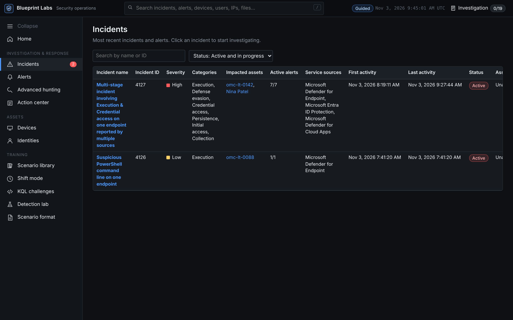 | 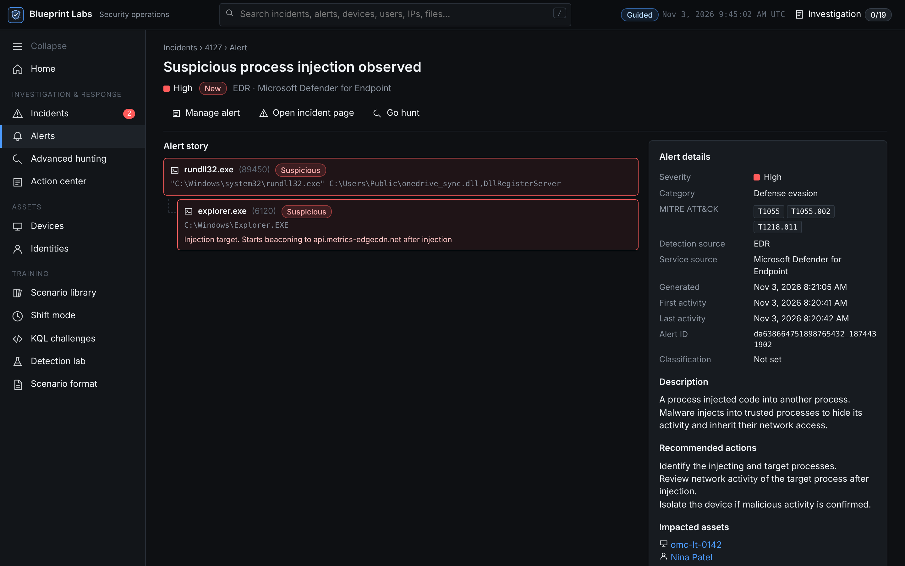 |
| **Incident queue.** Real attacks sit alongside harmless incidents that must be closed correctly. | **Alert story.** A process tree with command lines, highlighted nodes and linked files. |
| 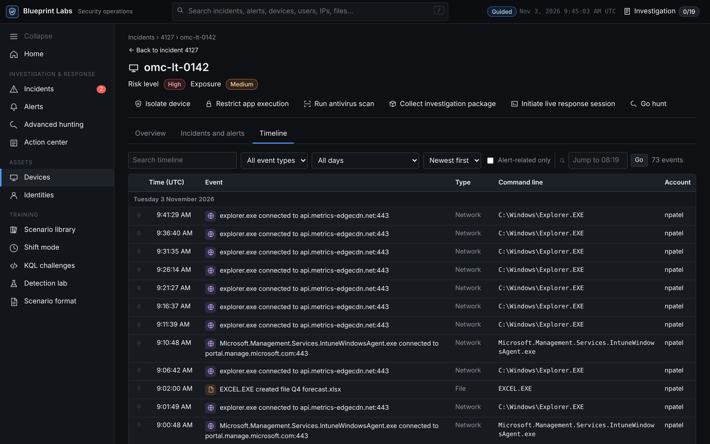 | 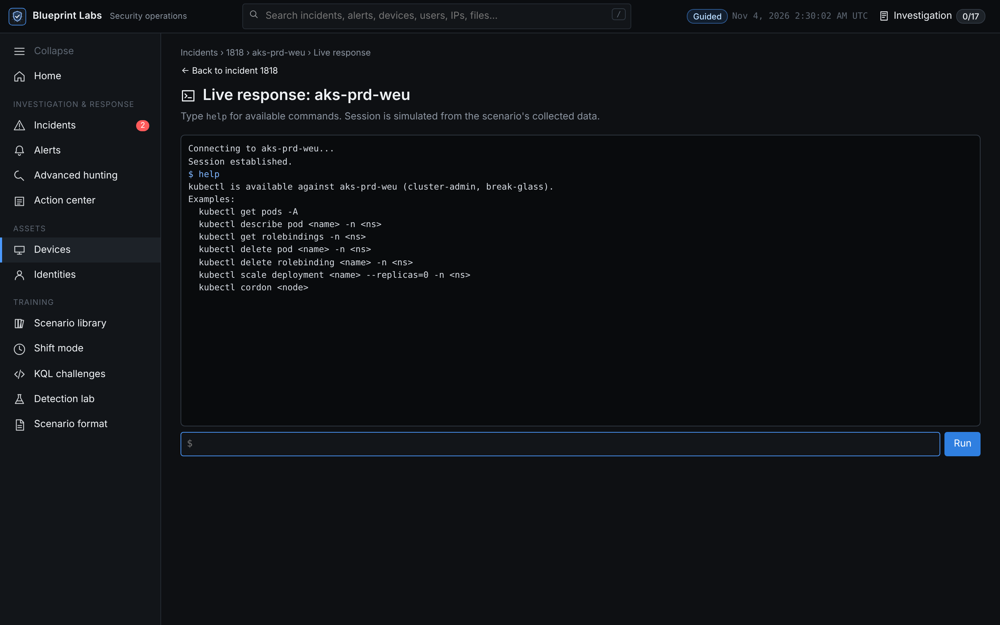 |
| **Device timeline.** Events with day dividers, jump-to-time and alert markers. | **Live response.** Simulated console sessions, including kubectl against an AKS cluster. |

### Advanced hunting with a purpose-built KQL engine

Every scenario ships with its own log tables, queried with KQL. The hunting page has syntax highlighting, autocomplete, a schema browser, resizable columns, click-to-filter cells, query history and pinned results.

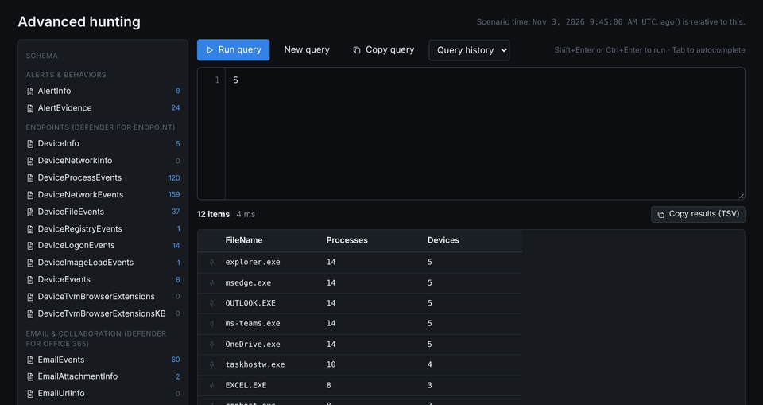

The engine supports the operators an analyst uses day to day: `where`, `project` and its variants, `extend`, `summarize`, `join` (all kinds), `lookup`, `union`, `mv-expand`, `parse`, `let`, `top`, `distinct` and more. It also handles a wide range of scalar and aggregation functions, datetime and timespan types, and dynamic columns. It covers 45 tables across Defender for Endpoint, Defender for Office 365, Defender for Identity, Defender for Cloud Apps, Entra ID and Sentinel, including AKS audit, container logs, Intune and Azure DevOps auditing.

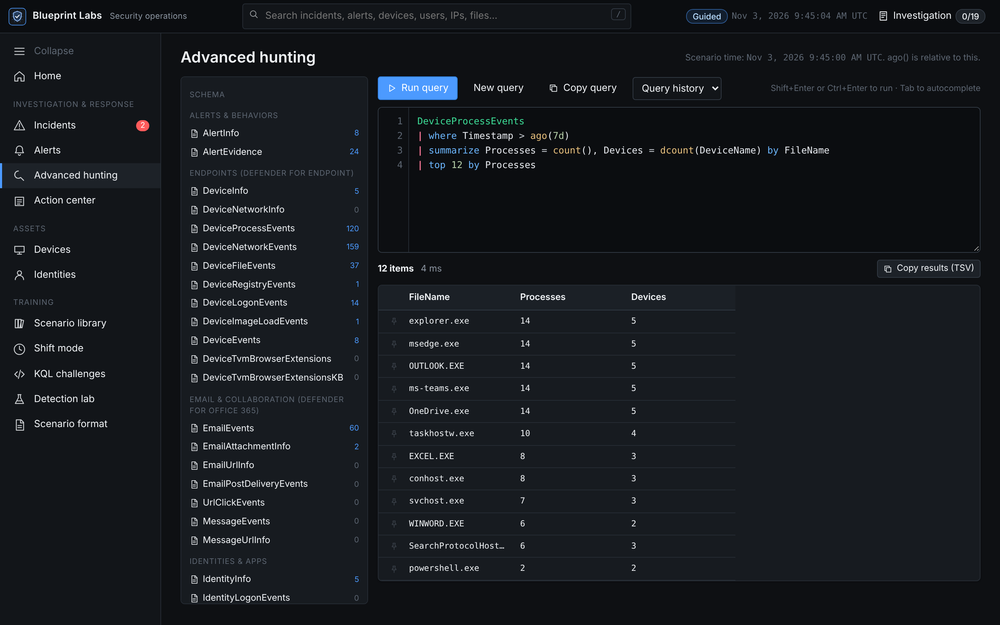

### Response actions with consequences

You don't just answer questions. You contain the incident with the actions you'd use in the real portal:

- **Devices:** isolate, restrict app execution, AV scan, collect an investigation package, live response
- **Users:** disable, revoke sessions, reset password, confirm compromised, remove MFA methods, remove inbox rules
- **Email and files:** soft or hard delete, block sender, quarantine files, block indicators
- **Apps and workload identities:** disable, revoke consent, remove credentials or role assignments

Actions are checked against what the scenario needs. Actions that would hurt the business cost points, such as isolating a domain controller or disabling a user who was deceived rather than malicious. In timed scenarios the attacker keeps moving: if you haven't contained them by a set point on the simulated clock, the next stage happens and new alerts arrive.

### Two ways to play

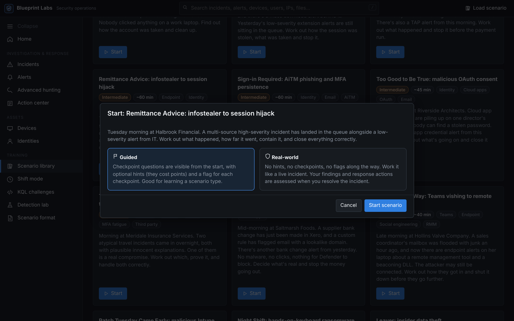

- **Guided:** checkpoints, hints (each one costs points) and flags as you go, in the style of TryHackMe. The clock runs at half speed.
- **Real-world:** no checkpoints and no hints. You investigate as you would on shift, then you're asked for your findings when you resolve, and assessed on them.

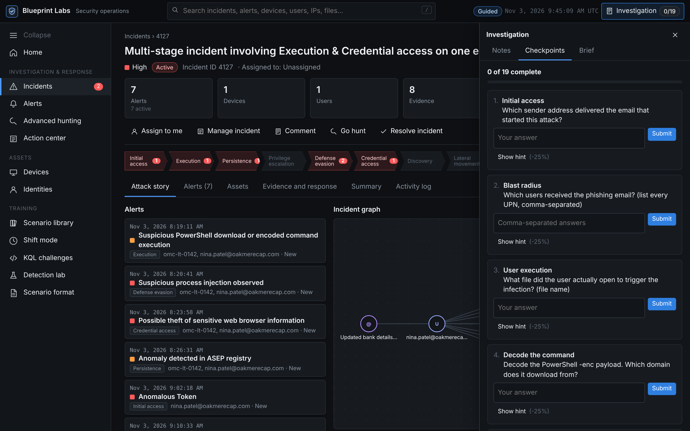

When an incident is resolved, the debrief shows your score, the full story of the attack, a timeline, every checkpoint with an explanation, lessons learned and the KQL queries that reveal the attack.

---

## Scenario library

20 scenarios across three difficulty levels. Every organisation, person and domain is fictional, and attacker infrastructure uses documentation IP ranges.

| # | Scenario | Level | Mins | Focus | Timed |
|---|----------|-------|------|-------|:-----:|
| 002 | Morning Shift: password spray to a successful sign-in | Beginner | 30 | Identity, Conditional Access | |
| 005 | Payroll Update: credential phishing link | Beginner | 25 | Email, Identity, MFA | |
| 008 | Busy Morning: three alerts, no attackers | Beginner | 30 | Triage, false positives | |
| 012 | Scan Me: QR code phishing | Beginner | 25 | Email, Identity, QR code | |
| 013 | Handy Little Helper: malicious browser extension | Beginner | 30 | Endpoint, token theft | |
| 014 | Lost Phone: service desk social engineering | Beginner | 25 | Identity, MFA, BEC | |
| 001 | Remittance Advice: infostealer to session hijack | Intermediate | 60 | Endpoint, Identity, BEC | |
| 003 | Sign-in Required: AiTM phishing and MFA persistence | Intermediate | 60 | AiTM, MFA, BEC | |
| 006 | Too Good to Be True: malicious OAuth consent | Intermediate | 45 | Cloud apps, OAuth | |
| 009 | Two Places at Once: impossible travel with a twist | Intermediate | 40 | Identity, MFA fatigue | |
| 015 | Change of Bank: supplier email compromise | Intermediate | 35 | BEC, fraud | |
| 016 | Help Is on the Way: Teams vishing to remote access | Intermediate | 40 | Teams, RMM tools | Yes |
| 017 | Patch Tuesday Came Early: malicious Intune script | Intermediate | 40 | Intune, privileged access | Yes |
| 004 | Night Shift: hands-on-keyboard ransomware staging | Advanced | 90 | Endpoint, lateral movement | Yes |
| 007 | Leaver: insider data theft | Advanced | 60 | Insider risk, DLP | |
| 010 | Trusted Update: supply-chain backdoor | Advanced | 75 | Supply chain, scoping | |
| 011 | Keys to the Kingdom: cloud privilege escalation | Advanced | 75 | Azure, workload identities | |
| 018 | Breaking Out: AKS container escape | Advanced | 75 | Kubernetes, Falco, Azure | |
| 019 | Roast and Replicate: Kerberoasting to DCSync | Advanced | 70 | Active Directory, Defender for Identity | Yes |
| 020 | Trusted Build: developer token theft to pipeline poisoning | Advanced | 75 | DevOps, supply chain | Yes |

Across the library there are 96 alerts and 280 checkpoints, mapped to MITRE ATT&CK techniques across initial access, execution, persistence, privilege escalation, credential access, lateral movement, exfiltration and impact.

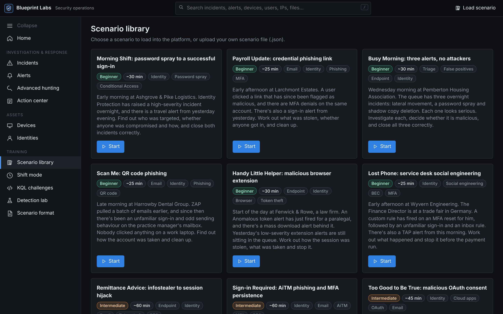

Every scenario includes:

- **Background noise:** normal sign-ins, processes, email and network traffic over several days, so the malicious activity has to be found rather than handed over.
- **At least one harmless incident** that looks suspicious and must be closed with the right classification. Knowing when *not* to act is part of the job.
- **Penalties** for actions that would hurt the business.
- **A debrief** with the full story, a timeline, lessons and the KQL queries that reveal the attack.

### What a scenario covers

Taking the AKS container escape scenario as an example (without spoilers), the analyst works across:

- Defender for Containers alerts and the incident graph
- Container logs, including Falco runtime alerts
- Kubernetes audit logs, to see what a service account asked the API for
- Live response with kubectl against the cluster
- Managed identity sign-ins, Azure activity and storage logs, to follow the attack from the cluster into the cloud
- Containment across Kubernetes, Entra ID and Azure RBAC

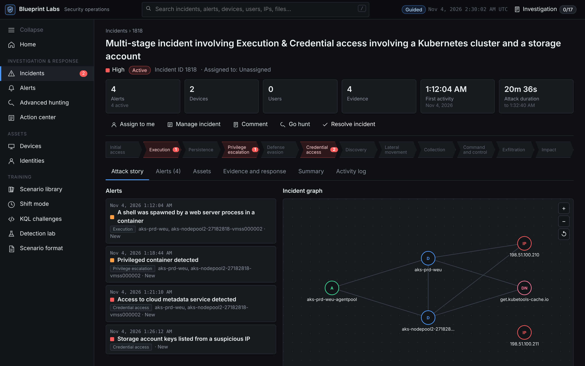

---

## Training modes

Beyond single investigations, the platform has three training modes, each for a different skill.

### Shift mode

A 25-minute triage shift with eight incidents drawn from across the library: some real attacks, some harmless. For each one you review the alerts, people, devices and related log rows, then classify it and set a priority. You're scored on verdicts and on getting to the real attacks first.

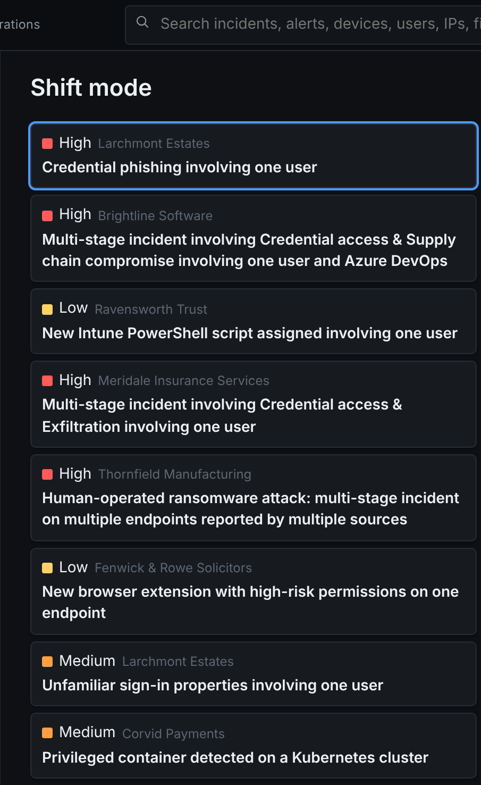

### KQL challenges

Six question packs (36 questions) answered by querying scenario datasets. A question is solved automatically when your result contains the answer, so the focus stays on writing the query. The packs range from sign-in log basics to parsing JSON and walking nested Kubernetes audit objects.

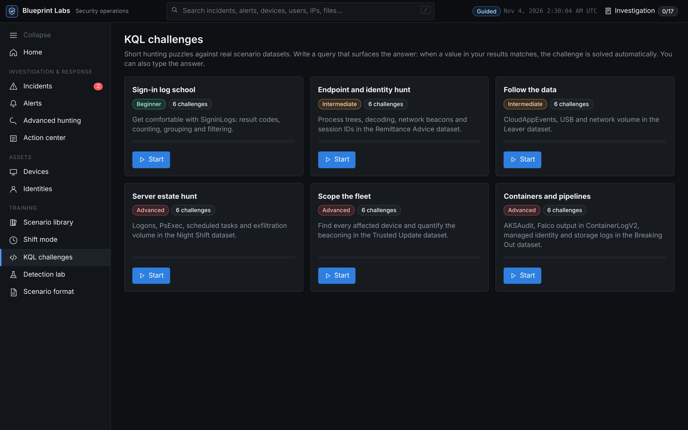

### Detection lab

14 labs where you write a detection rule against a scenario's logs. Your query is scored on **recall** (how many malicious events it catches) and **false positives** (how many harmless events would also alert). A rule that catches everything but also fires on legitimate admin activity doesn't pass.

| | |
|---|---|
| 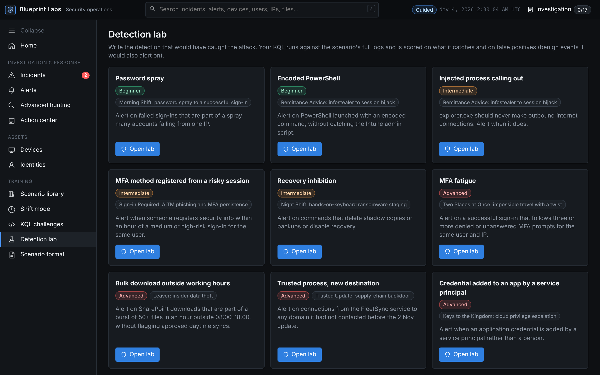 | 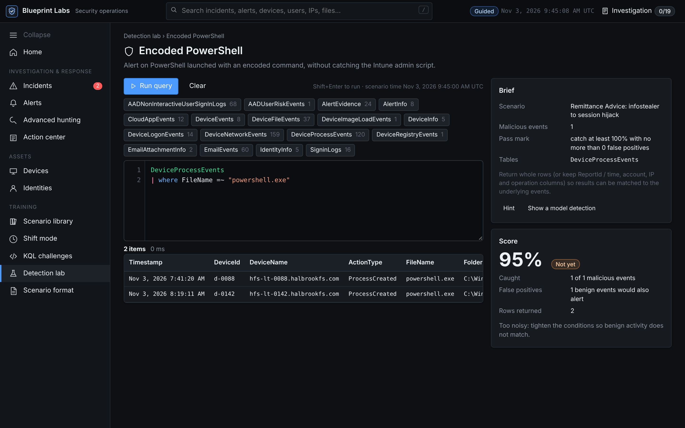 |

Labs include password spray, encoded PowerShell, MFA fatigue, Kerberoasting, DCSync from a non-DC, privileged pods outside system namespaces, email bombing, OAuth consent abuse and a trusted process contacting a new destination.

### Write-up review

Investigation notes are reviewed at the debrief against what a complete report should contain for that incident: key findings, actions taken, IOCs, timestamps and report structure (summary, scope, timeline, root cause, containment, recommendations and classification).

---

## Design decisions

**Realism over polish.** Alert titles, table names and columns follow Microsoft's, so KQL written here works in production with little or no change. Scenarios include the messy details real incidents have, like genuine-looking senders, leftover permissions and attackers who blend in with normal traffic.

**Judgement is scored, not just answers.** Every scenario includes harmless incidents and penalises harmful actions. Over-reacting in a real SOC causes its own incident.

**Time pressure where it's realistic.** Five scenarios have timed escalations. If the attacker reaches their next stage before you contain them, it happens, and the debrief explains which action would have stopped it.

**Scenarios are data, not code.** Each scenario is a single file describing the organisation, users, devices, alerts, log tables, checkpoints, penalties and debrief. The platform starts empty and loads them, so new scenarios need no code changes.

**Every answer is verified.** Builder scripts generate each scenario, and an automated check runs every debrief query, checkpoint answer and detection lab against the data. Challenge answers are computed by running their model queries, so they always match the data.

**No accounts, no backend.** It runs entirely in the browser and stores progress locally, which keeps it fast, private and usable on a laptop or a phone.

| | |
|---|---|
| 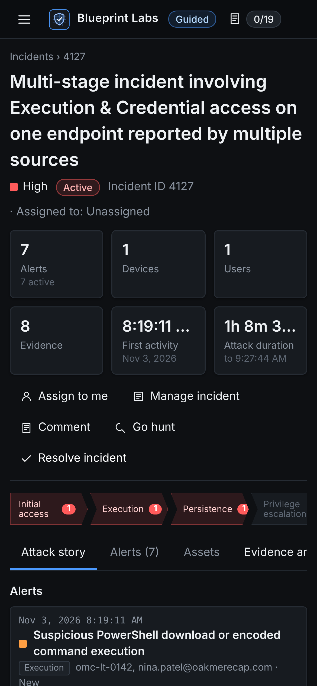 | 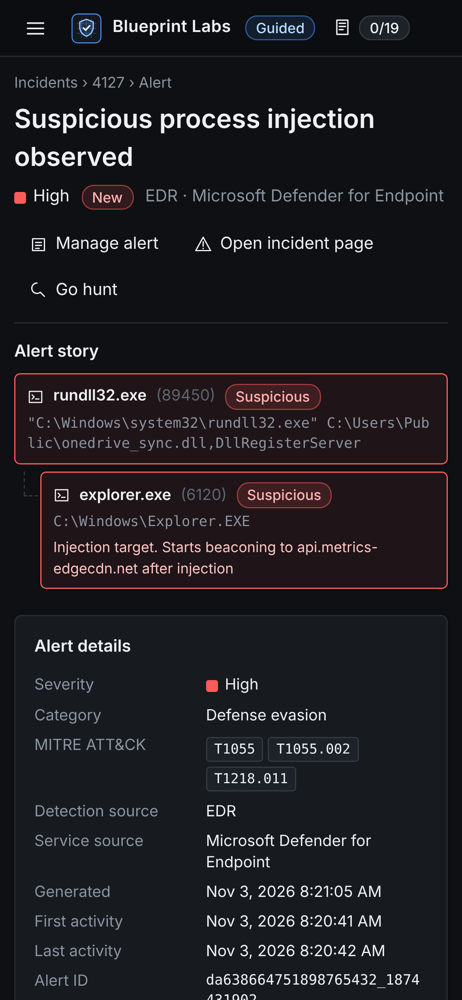 |

---

## How it works

```
Browser (static site, no build step)
├── Portal UI          incident queue, incidents, alerts, devices, identities,
│                      entities, action center, live response, debrief
├── KQL engine         lexer, parser and evaluator written for the platform
├── Training modes     shift mode, KQL challenges, detection lab, write-up review
└── Scenario loader    reads scenario files, builds log tables, runs the clock,
                       tracks checkpoints, actions, penalties and escalations

Scenario builders (offline)
├── World model        fictional org, users, devices, normal behaviour
├── Noise generator    days of background activity per user and server
├── Attack script      the incident itself, written event by event
└── Verification       every query, answer and lab checked against the data
```

- **Front end:** vanilla JavaScript, HTML and CSS. No framework or build step.
- **Scenario tooling:** Python builders on a shared library that models an organisation and generates realistic telemetry.
- **Checks:** a Node test harness for scenario validation, and Playwright for browser testing on desktop and mobile layouts.
- **Hosting:** private GitHub repository, with a private hosted build for desktop and mobile.

---

## How it was built

Blueprint Labs was built with Claude (Anthropic's AI) as the engineering partner.

- **Lawrence Wilkins:** product direction, requirements and feature priorities, scenario topics and learning goals, defining what "realistic" meant against day-to-day work in Defender and Sentinel, reviewing every scenario and screen, and testing as the end user on desktop and mobile.
- **Claude:** writing the code (including the KQL engine and scenario builders), generating scenario data to specification, and running the automated checks.

Development was iterative: use the platform, find what doesn't match real portal behaviour or real attacker tradecraft, and change it.

---

## Roadmap

- More scenarios, including Defender for Cloud Apps session policies, mailbox audit deep dives and multi-day intrusions
- A scenario editor, so scenarios can be written without the builder scripts
- Progress and skills tracking across scenarios, such as identity, endpoint, cloud and email
- Team mode: an instructor assigns scenarios and reviews analysts' write-ups
- Optional sync of progress between devices

---

## About

Built by **Lawrence Wilkins**. The platform repository is private while in active development.
